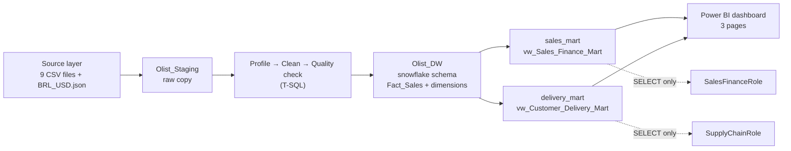
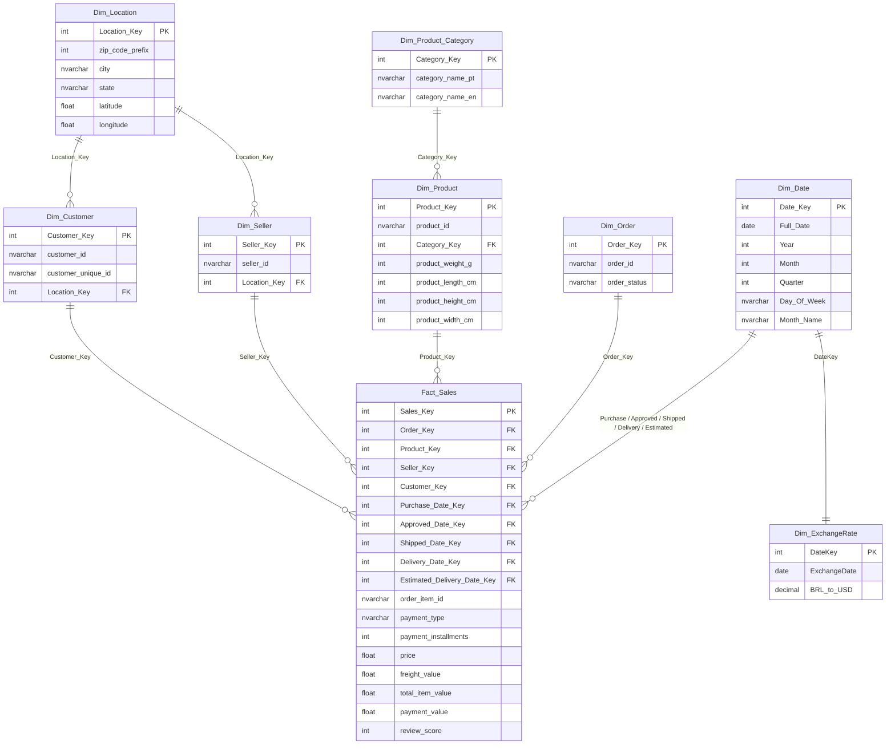

# Olist E-Commerce Data Warehouse & Business Intelligence Solution

**IT3101 – Data Warehousing & Business Intelligence | Year 3, Semester 1 – 2026 | Group 2026-DS-01**
Sri Lanka Institute of Information Technology (SLIIT)

An end-to-end data warehousing and BI project built on the **Olist Brazilian E-Commerce** dataset.
Raw operational data is loaded into a staging database, profiled, quality-checked and cleaned, then
loaded into a **snowflake-schema data warehouse** on SQL Server. Two virtual data marts with
role-based security sit on top, and a **3-page Power BI dashboard** presents the results.

## Team

| Student ID | Name |
|---|---|
| IT24103059 | Premasekara J J |
| IT24103100 | Gallage D D |
| IT24102404 | Wijesinghe H D M |
| IT24102465 | Jayawardhana R M D O S |

## Table of contents

1. [Business problem](#1-business-problem)
2. [Architecture](#2-architecture)
3. [Tech stack](#3-tech-stack)
4. [Repository structure](#4-repository-structure)
5. [Data sources](#5-data-sources)
6. [Data preparation (profile → clean → check)](#6-data-preparation-profile--clean--check)
7. [Data warehouse design](#7-data-warehouse-design)
8. [ETL and script run order](#8-etl-and-script-run-order)
9. [Data marts and security](#9-data-marts-and-security)
10. [Power BI dashboard](#10-power-bi-dashboard)
11. [Business insights and recommendations](#11-business-insights-and-recommendations)
12. [Known limitations](#12-known-limitations)
13. [How to reproduce](#13-how-to-reproduce)
14. [AI tools acknowledgement](#14-ai-tools-acknowledgement)
15. [Data source and licence](#15-data-source-and-licence)

---

## 1. Business problem

Olist is a Brazilian platform that connects small and medium sellers to large online marketplaces. Its
operational (OLTP) database is built for fast transaction processing, so analytical questions need many
repeated joins over normalised tables. Management therefore cannot easily answer questions such as:

- Which regions have the highest delivery delays?
- Which product categories drive the most revenue?
- How do payment installments and delivery performance affect customer review scores?

This project transforms the operational data into a warehouse optimised for fast, historical,
multi-dimensional analysis.

## 2. Architecture



| Layer | Component | Purpose |
|---|---|---|
| Data source | 9 Olist CSV files, `BRL_USD.json` | Raw operational data and an external currency lookup |
| Data integration (ETL) | T-SQL scripts | Extract to staging, transform (profile → clean → check), load to the warehouse |
| Storage | `Olist_Staging`, `Olist_DW`, data marts | Isolated cleaning area, enterprise warehouse, departmental views |
| Presentation | Power BI, SQL reports | Dashboards and OLAP-style analysis (drill-down, roll-up, slice, dice, pivot) |

## 3. Tech stack

- **Microsoft SQL Server** and **SQL Server Management Studio (SSMS)**: T-SQL for all ETL, schema and security scripts
- **Power BI Desktop**: dashboard and DAX measures
- Source formats: CSV and JSON (`OPENROWSET`, `OPENJSON`)

## 4. Repository structure

```
.
├── README.md
├── IT3101_2026-DS-01.pdf            Final project report
├── Olist_Queries/                   All T-SQL scripts (see section 8 for run order)
├── Olist_Dashboard/                 Power BI dashboard files
├── Olist_Data/                      Reference data (BRL_USD.json); raw Kaggle CSVs are not tracked
└── Olist_Data_Warhouse_Backups/     Database backups (not tracked in Git: too large)
```

## 5. Data sources

The 9 Olist CSV files were loaded into dedicated tables in `Olist_Staging` with no row filtering, then
verified against the originals.

| Staging table | Description | Rows |
|---|---|---:|
| `Customer` | Customer identifiers and location | 99,441 |
| `Geolocation` | Zip-code-level latitude/longitude points | 999,861 |
| `OrderItems` | Line items per order (product, seller, price, freight) | 112,650 |
| `OrderPayments` | Payment method, installments and value | 103,886 |
| `OrderReviews` | Review score and comments | 99,224 |
| `Orders` | Order header and milestone timestamps | 99,441 |
| `Products` | Product catalogue and physical dimensions | 32,951 |
| `Sellers` | Seller identifiers and location | 3,095 |
| `ProductCategoryNameTranslation` | Portuguese → English category lookup | 72 |

An additional external file, **`BRL_USD.json`**, provides daily BRL → USD exchange rates.

## 6. Data preparation (profile → clean → check)

Every table follows the same repeatable workflow, implemented as separate T-SQL scripts:

1. **Profile**: read-only queries measuring volume, key uniqueness, NULL/blank values, domain ranges
   (negative prices, scores outside 1-5, invalid zip codes), outliers, referential integrity and temporal logic.
2. **Clean**: targeted fixes based on the profiling evidence. The guiding rule is to **standardise or set
   invalid values to NULL rather than delete rows**, so valid parts of a record are kept.
3. **Quality check**: re-run rule checks to confirm the issues are resolved and foreign-key relationships hold.

| Table | Issue found | Fix applied |
|---|---|---|
| Geolocation | 302 coordinates outside Brazil's bounding box | Deleted those rows; trimmed text |
| Orders | Approval/carrier/delivery timestamps earlier than the previous milestone | Set invalid timestamps to NULL; trimmed and lower-cased status; blank → NULL |
| OrderPayments | `not_defined` payment type; negative values; installments ≤ 0 | `not_defined` → `Unknown`; invalid numbers → NULL |
| OrderReviews | Scores outside 1-5; blank comments | Invalid scores → NULL; blank comments → NULL; trimmed |
| Products | Missing categories; dimensions/weight ≤ 0; non-numeric photo counts | Category → `Unknown`; invalid values → NULL |
| Customer | Leading/trailing spaces | `LTRIM`/`RTRIM` |
| ProductCategoryNameTranslation | Spacing; blanks; some categories without English translation | Trimmed; blank → NULL; original Portuguese name kept where no translation exists |
| ExchangeRate | Missing days (rates exist for business days only) | Forward-fill from the previous available rate |
| Sellers, OrderItems | Checked duplicates, key lengths, orphans | No major errors; trimming only |

**Cross-table checks** (orders without items, cancelled-but-paid orders, review scores of late orders,
orphan records, categories without translation) are in the cross-table scripts under `Olist_Queries/`.

## 7. Data warehouse design

A **snowflake schema** was chosen because location and category data are shared, normalised lookups:
one location row serves both customers and sellers, and the category translation is stored once.



> The diagram follows `Snowflake_Schema_Query.sql`. The four USD columns (`price_usd`, `freight_value_usd`,
> `payment_value_usd`, `total_item_value_usd`, all `DECIMAL(18,2)`) are added to `Fact_Sales` later by
> `Adding_Currency_columns_to_fact_table.sql`.

**Fact table: `Fact_Sales`**

| Property | Definition |
|---|---|
| Business process | Sales: one product item sold to a customer and fulfilled by a seller within an order |
| Grain | **One row per order item** (matches `olist_order_items_dataset`) |
| Measures | `price`, `freight_value`, `total_item_value`, `payment_value`, `review_score`, and the four `*_usd` measures |
| Degenerate attributes | `order_item_id`, `payment_type`, `payment_installments` |

**Design choices**

- **Role-playing dimension:** one `Dim_Date` is used five times (purchase, approved, shipped, delivery, estimated delivery).
- **Outriggers:** `Dim_Location` (shared by customers and sellers), `Dim_Product_Category`, and `Dim_ExchangeRate` (linked to `Dim_Date`).
- **Surrogate keys:** `IDENTITY` integers on all dimensions except `Dim_ExchangeRate`, where `DateKey` is the natural key; `Dim_Date` uses a `YYYYMMDD` integer key.
- **Nullable keys:** milestone date keys can be NULL for orders that never reached that stage (for example cancelled or undelivered orders).
- **Currency:** the BRL → USD rate is taken from the **purchase date**; weekend/holiday gaps are forward-filled.
- **No slowly changing dimensions:** the source is a fixed historical snapshot (2016-2018).
- **Order-level values** (`payment_value`, `review_score`) repeat across the items of a multi-item order so the fact grain stays uniform.

## 8. ETL and script run order

Dimensions are loaded **before** the fact table because `Fact_Sales` needs the dimension surrogate keys and
enforces them with foreign keys. Parent outriggers load before the dimensions that reference them.

| Step | Phase | Scripts (in `Olist_Queries/`) | Database |
|---:|---|---|---|
| 1 | Extract and verify | `source_row_count_validation.sql`, `row_count_check.sql`, `ExchangeRate_staging_table_creation & loading.sql` | Olist_Staging |
| 2 | Profile | `<Table>_profiling.sql` for each table, `All_tables_data_profiling.sql`, `ExchangeRate_data_profiling.sql` | Olist_Staging |
| 3 | Quality check | `<Table>_quality_checking.sql` for each table, `All_tabels_data_quality_Checking.sql`, `Data_Profiling & Quality_Checking_By_Joining_Staging_Tables.sql`, `ExchangeRate_data_quality_checking.sql` | Olist_Staging |
| 4 | Clean | `Customer_`, `Geolocation_`, `Orders_`, `Products_`, `OrderPayments_`, `OrderReviews_`, `ProductCategoryNameTranslation_` + `cleaning.sql` | Olist_Staging |
| 5 | Create warehouse | `Snowflake_Schema_Query.sql` | Olist_DW |
| 6 | Load dimensions | `Dim_Date_loading.sql` → `Dim_Location_loading.sql` → `Dim_Customer_loading.sql` → `Dim_Seller_loading.sql` → `Dim_Product_Category_loading.sql` → `Dim_Product_loading.sql` → `Dim_Order_loading.sql`, and the exchange-rate dimension (see note) | Olist_DW |
| 7 | Load fact | `Fact_Sales_loading.sql` | Olist_DW |
| 8 | Add USD measures | `Adding_Currency_columns_to_fact_table.sql`, then `ExchangeRate_cleaning.sql` (fills remaining missing rates and USD values) | Olist_DW |
| 9 | Validate | `Check_All_Data_Between_Staging & DW.sql` (expects zero unmatched records) | Olist_DW |
| 10 | Marts and security | `virtual_data_marts_and_roles_setup.sql` | Olist_DW |

> **Notes**
> - `Loading_data_from_Staging_area_to_DW.sql` is a composite script containing the same dimension and fact loads as the individual `Dim_*_loading.sql` and `Fact_Sales_loading.sql` files. Use **either** the composite script **or** the individual files, not both.
> - **Dim_ExchangeRate** can be populated either from the staging `ExchangeRate` table (inside the composite script) or directly from the JSON file (`Dim_ExchangeRate_creation & loading.sql`). <!-- TODO: team to confirm which version is final and delete this note -->
> - `OrderReviews_profiling.sql` converts `review_score` to `INT`; run it (or the equivalent change) before the review cleaning and quality scripts that compare scores numerically.

## 9. Data marts and security

Two **virtual data marts** are implemented as SQL views in separate schemas, so there is no data duplication
and the data is always current.

| Data mart | View | For | Highlights |
|---|---|---|---|
| Sales & Finance | `sales_mart.vw_Sales_Finance_Mart` | CFO, financial controllers, revenue analysts | Date, category, seller, customer, payment type/installments, BRL values, `BRL_to_USD`, `Total_Value_USD` |
| Customer Delivery | `delivery_mart.vw_Customer_Delivery_Mart` | Logistics, supply chain and customer-experience teams | Order status, customer/seller state, `Actual_Delivery_Days`, `Is_Late_Delivery`, `review_score` |

**Role-based access control (least privilege)**

| Login | Database user | Role | Permission |
|---|---|---|---|
| `SalesAnalystLogin` | `SalesAnalystUser` | `SalesFinanceRole` | `SELECT` on `sales_mart.vw_Sales_Finance_Mart` only |
| `SupplyChainLogin` | `SupplyChainUser` | `SupplyChainRole` | `SELECT` on `delivery_mart.vw_Customer_Delivery_Mart` only |

Users never access the base warehouse tables. **The login passwords in the script are placeholders. Set
strong passwords before running it.**

## 10. Power BI dashboard

Three report pages, each with Year / Quarter / Month slicers and a BRL / USD toggle.

<!-- Add screenshots here once exported, for example:


-->

### Page 1: Executive Overview

KPI cards (all data, USD): **98.67K orders**, **$47.84 average order value**, **$4.72M revenue**,
**0.47% cancellation rate**, **4.03 average review score**.
Visuals: monthly revenue and orders by year (line), revenue by product category (bar), order revenue by
location and status (map), revenue by state (bar).

### Page 2: Trend Analysis

KPI cards: Peak Sales Month (**November 2017**), YoY / MoM / QoQ revenue difference, average order value.
Visuals: monthly revenue by year (column), **revenue moving averages (7 / 14 / 30 / 50-day)** (multi-line),
monthly revenue ranking by state (ribbon/area), monthly orders and average order value (combo).
The 7- and 14-day averages react quickly and show the short-term trend; the 30- and 50-day averages are
smoother and show the longer-term direction.

### Page 3: Operations & Supplier Performance

KPI cards (all data): **93.40% on-time delivery**, **2.803 days average dispatch time**, **3.10K sellers**,
**$1.52K average seller revenue**, freight YoY.
Visuals: revenue by payment type and installments (donut), average review score and revenue by category
(combo), dispatch time vs product weight by month (combo), supplier reliability vs defect rate (scatter).

**Key measure definitions (Page 3)**

| Measure | Definition |
|---|---|
| On-Time Delivery % | Average of the 0/1 `Is_On_Time` flag |
| Supplier Reliability % | Equal to On-Time Delivery % per seller |
| Defect Rate % | Share of a seller's order items that were **cancelled or received a review score of 2 or below** |
| Risk tier | `Low Volume` (fewer than 10 order items), `High` (defect rate ≥ 40%), `Medium` (≥ 25%), otherwise `Low` |

**OLAP operations supported:** drill-down (Year → Quarter → Month → Day, State → City), roll-up, slice,
dice, and pivot (re-orienting categories against months).

## 11. Business insights and recommendations

1. **Seasonality:** revenue and orders peak in Q4, especially November (Black Friday and holiday shopping).
2. **Regional concentration:** the south-east dominates, led by São Paulo (SP), then Rio de Janeiro (RJ) and Minas Gerais (MG).
3. **Top categories:** revenue is concentrated in a few categories (for example health_beauty, bed_bath_table, watches_gifts, sports_leisure, computers_accessories).
4. **Payments:** credit cards are the most used method (often with multiple installments), followed by boleto; cancellation rates are very low.
5. **Operations:** on-time delivery is high and seller dispatch is quick.
6. **Delivery speed vs reviews:** late deliveries receive noticeably lower review scores (supported by the cross-table profiling of review scores for late orders).
7. **Seller groups:** sellers differ widely; some combine quick dispatch with low defect rates while others show delays and higher defect rates.

**Recommendations**

1. **Q4 inventory preparation** for the top categories before November.
2. **Regional distribution hubs** in SP, RJ and MG to speed up delivery and reduce freight cost.
3. **Seller support and quality control**: guidelines and dispatch tracking for underperforming sellers.

## 12. Known limitations

- **Possible row multiplication in the fact load:** payments and reviews are joined at item level, so an order with several payments or reviews can multiply its item rows. Order-level measures such as `payment_value` should not be summed naively.
- **Default location key:** customers/sellers whose zip code is missing from the geolocation table fall back to `Location_Key = 1` rather than an explicit "Unknown" row.
- **Location attributes:** `Dim_Location` takes `MAX(city)` / `MAX(state)` and averages coordinates per zip prefix, which is a pragmatic simplification where a zip maps to several spellings.
- **Fixed calendar:** `Dim_Date` covers 2016-2018 only.
- **Money as FLOAT:** `price`, `freight_value`, `total_item_value` and `payment_value` use `FLOAT`; `DECIMAL` would avoid rounding errors.
- **No slowly changing dimensions** and **no incremental load**: the pipeline is a full historical load.
- **Incomplete final months:** the data ends around August/September 2018, so the last month is partial and charts drop sharply at the end.
- **Hard-coded path:** exchange-rate scripts read `C:\Olist_Data\BRL_USD.json`.
- **Cancelled-but-paid orders** are profiled but not automatically corrected, because they need business validation.

## 13. How to reproduce

**Prerequisites:** SQL Server with SSMS, Power BI Desktop, the Olist dataset from Kaggle, and `BRL_USD.json`.

1. Create the databases `Olist_Staging` and `Olist_DW`.
2. Download the Olist dataset (see below) and load the 9 CSV files into staging tables named as in section 5.
   The project used T-SQL `BULK INSERT`. <!-- TODO: add your exact load method or import wizard steps -->
3. Place `BRL_USD.json` at `C:\Olist_Data\BRL_USD.json`, or edit the path in the exchange-rate scripts.
4. Run the scripts in the order given in [section 8](#8-etl-and-script-run-order).
5. Before step 10, replace the placeholder passwords in `virtual_data_marts_and_roles_setup.sql`.
6. Open the Power BI file in `Olist_Dashboard/` and point its data source to your SQL Server instance.

## 14. AI tools acknowledgement

AI tools were used as an assistant only, for: reviewing T-SQL schema scripts, drafting DAX formulas
(moving averages, YoY), and organising and proofreading the report. All project ideas, database testing,
script execution, DAX verification and dashboard creation were completed, tested and approved by the team.

## 15. Data source and licence

- **Dataset:** Olist Brazilian E-Commerce Public Dataset (Kaggle). Please check the dataset page for its licence terms before redistributing any of the data.
- **Exchange rates:** BRL → USD daily rates from `BRL_USD.json`. <!-- TODO: name the API/source and its terms -->
- The raw dataset is not included in this repository.
